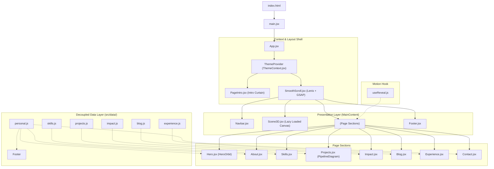
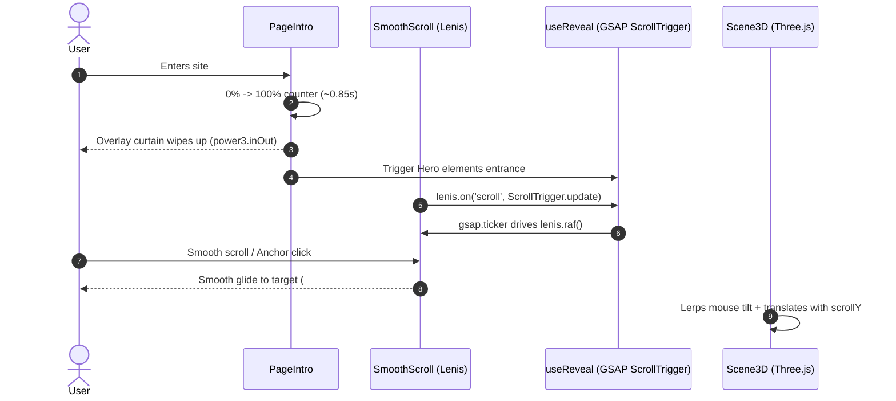

# System Architecture: Yashodip Jejurkar Portfolio

This document outlines the architecture, data flow, motion design, and rendering lifecycle of the portfolio website.

---

## 1. High-Level Architecture

The application is structured as a client-side Single Page Application (SPA) built on **React 19** and **Vite 8**, powered by modern styling via **Tailwind CSS v4** and synchronized creative motion via **Lenis**, **GSAP**, and **Three.js**.

---

## 2. Theme & Design System Pipeline

Theme state is decoupled from rendering and operates through a synchronized 3-layer pipeline:

1. **State & Persistence**:
   - `ThemeContext.jsx` manages `'dark' | 'light'` state.
   - Synchronizes with `localStorage` (`yj_devops_theme`), defaulting to `'dark'`.
   - Modifies the `.dark` class directly on `document.documentElement`.
2. **Semantic Design Tokens (CSS Variables)**:
   - Defined in `src/index.css` via `:root` (light) and `.dark` (dark).
   - Variables: `--bg`, `--surface`, `--surface-2`, `--border`, `--text`, `--muted`, `--accent`.
   - Tailwind CSS v4 `@theme inline` binds Tailwind utilities (`bg-bg`, `text-accent`, `border-border`) directly to these CSS variables.
3. **Reactive Canvas & Components**:
   - WebGL materials in `Scene3D.jsx` and SVG icons in `HeroOrbit.jsx` consume `useTheme()` to recalculate palette values reactively without page reloads.

---

## 3. Motion & Animation Architecture

Animations follow a strict performance-first model, ensuring 60fps across mobile and desktop.

### Component Breakdown:
1. **`PageIntro.jsx`**:
   - Displays a lightweight terminal sequence and monospace counter `0% -> 100%` in ~0.85s.
   - Smoothly wipes up with `ease: 'power3.inOut'` and unmounts from DOM.
   - Bypassed immediately if `prefers-reduced-motion` is enabled.
2. **`SmoothScroll.jsx`**:
   - Initialized via `lenis` and tightly bound to GSAP's ticker (`gsap.ticker.add((time) => lenis.raf(time * 1000))`).
   - `lenis.on('scroll', ScrollTrigger.update)` guarantees zero desynchronization between smooth momentum scroll and viewport triggers.
   - Handles anchor clicks (`#about`, `#skills`, `#projects`, `#contact`) with offset calculation.
   - Respects touch platforms via native pass-through to prevent scroll lag.
3. **`useReveal.js`**:
   - Wrapped in `gsap.context()` for clean lifecycle management and teardown on unmount.
   - Parallax on hero text via subtle scrub (`scrub: 0.5`).
   - Staggered card entrances (`stagger: 0.07`, `duration: 0.65s`, `power3.out`).
   - Section accent bar scale-wipes.
4. **`Scene3D.jsx`**:
   - Fixed background canvas (`z-index: -1`, `pointer-events: none`).
   - Wireframe icosahedron + geometric core + particle constellation.
   - Interpolates mouse movement with linear interpolation (`lerp`).
   - Translates along the Y and Z axis proportional to `scrollY`.
   - Performance safeguards: `dpr={[1, 2]}`, `frameloop="never"` when tab is hidden or reduced motion is active.
5. **`HeroOrbit.jsx` & `HeroOrbit.css`**:
   - Pure CSS 3D planetary orbit (`perspective: 1200px`, `transform-style: preserve-3d`, `rotateX(65deg)` orbital planes).
   - Three concentric tilted rings: Inner (`25s` CW, 5 icons / 4 mobile), Middle (`38s` CCW, 5 icons / 4 mobile), Outer (`55s` CW, 6 icons / 5 mobile).
   - Billboard counter-rotation (`rotateZ` inverse + `rotateX(-65deg)` + inverse mouse tilt) keeps icon cards upright and viewer-facing at all angles.
   - Depth-based scaling and opacity (`translateZ`, `scale`, `opacity`) make rear icons smaller/dimmer and front icons larger/brighter.
   - Desktop mouse tilt up to `10deg` via `requestAnimationFrame` (`>= 1024px` + `@media (hover: hover)`).
   - Pauses animations when the browser tab is hidden (`visibilitychange`), and `prefers-reduced-motion: reduce` disables rotation, float, and tilt.

---

## 4. Data Layer Architecture

All portfolio content is decoupled from React presentation files into `src/data/`:
- **`personal.js`**: Central bio, contact info, availability, social URLs, and location.
- **`skills.js`**: Toolchain cards, category IDs (`cicd`, `containers`, `cloud`, `iac-security`, `monitoring`, `backend-db`, `system`), proficiency levels, and tags.
- **`projects.js`**: Architecture case studies, tech tags, metrics, GitHub and live documentation links.
- **`experience.js`**: Timeline history, milestones, and enterprise infrastructure accomplishments.
- **`impact.js`**: Measurable SLA, RPO/RTO, and automation metrics.
- **`blog.js`**: Deep-dive technical articles, summaries, and LinkedIn URLs.

---

## 5. Performance & Accessibility Standards

- **Asset Optimization**: High-resolution photography served in WebP with explicit width and height (`200x200`) and `loading="eager"`.
- **Code Splitting**: Heavy 3D modules (`three`, `@react-three/fiber`) are isolated into an asynchronous chunk via `React.lazy()` and `<Suspense fallback={null}>`. Resume PDF generation (`@react-pdf/renderer` and `src/components/resume/ResumeDocument.jsx`) is also dynamically imported on demand via `src/lib/downloadResume.js` when the user clicks Download Resume, with a fallback to `public/resume.pdf`.
- **Accessibility**: Comprehensive `prefers-reduced-motion: reduce` guards disable all 3D rotations, smooth scroll hijacking, and intro overlays for sensitive users.
- **Clean Teardown**: All listeners, RAF tickers, and ScrollTriggers are explicitly reverted on unmount.
